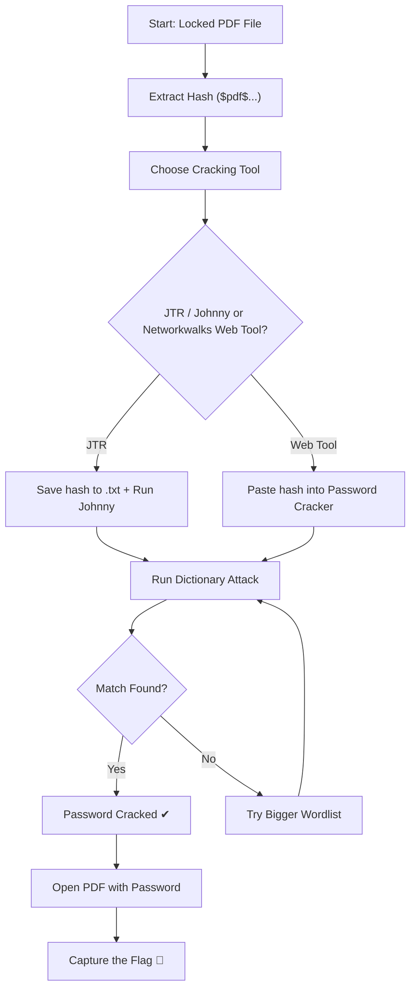

<div align="center">


<br/>


</div>

---

## 👨‍💻 About This Repository

Welcome to **Password Cracking Labs** — a hands-on learning repository documenting my journey through password auditing and cracking, built as part of the **Cybersecurity & Ethical Hacking** training program at **Networkwalks Academy**, under the guidance of **Waqas Karim (CCIE)**.

This repo covers:

- Extracting password hashes from locked PDF files
- Using **John the Ripper (JTR)** and its GUI **Johnny**
- Using Networkwalks' own **Hash Calculator** and **Password Cracker** web tools
- Running dictionary-based attacks against real locked PDFs
- Capturing and documenting flags from each cracked file
- Understanding hashing vs. encryption at a conceptual level

**My goal:** Learn how real-world password auditing works, understand hash extraction and cracking techniques, and build strong fundamentals in cybersecurity through practice.

> Learn it. Crack it. Document it. Share it.

---

## ⚡ Why Password Cracking Matters

Password cracking is the process of recovering a password from stored data or a protected file. Security professionals use it to test password strength and show why weak passwords put systems at risk.

When a file like a PDF, ZIP, or Office document is locked, its password is stored as a **hash** — a scrambled value representing the real password. To recover it:

1. Extract the hash from the locked file (`$pdf$...` format, pdf2john/hashcat-compatible)
2. Run it through a cracking tool with a wordlist
3. The tool tries candidates until it finds a match

**Fact:** A simple 8-character lowercase password can be cracked in minutes. A strong 12+ character mixed password can take years.

---

## 🧠 Learning Roadmap

| Stage | Topics Covered |
|---|---|
| 🟢 Beginner | Hashing basics, encryption vs. hashing, tool installation |
| 🟢 Beginner | Extracting hashes from locked PDFs |
| 🔵 Intermediate | Dictionary attacks using JTR & Johnny GUI |
| 🔵 Intermediate | Using browser-based cracking tools (no install) |
| 🟣 Advanced | Custom wordlists & cracking strategy |
| 🔴 Practical | Capturing flags & documenting results |

---

## 🛠️ Tools & Environment

- **Kali Linux** (running in Oracle VirtualBox)
- **John the Ripper (JTR)** — https://www.openwall.com/john/
- **Johnny** (GUI for JTR) — https://openwall.info/wiki/john/johnny
- **Networkwalks Hash Calculator** — https://networkwalks.com/hash-calculator/
- **Networkwalks Password Cracker** — https://networkwalks.com/password-cracker/
- **Online PDF Hash Extractor** — https://www.onlinehashcrack.com/tools-pdf-hash-extractor.php

---

## 🔐 Understanding Hashes vs. Encryption

| Concept | Direction | Purpose |
|---|---|---|
| Encryption | Two-way (reversible with key) | Protect sensitive information |
| Hashing | One-way (not reversible) | Validate / verify information |

A locked PDF stores its password as a hash. The cracking tool doesn't "decrypt" the password — it hashes candidate guesses and compares them against the stored hash until a match is found.

---

## ⚔️ Lab Workflow

### Method 1 — John the Ripper + Johnny (GUI)

```bash
# Extract hash from PDF (via pdf2john or online extractor)
# Save it into a text file
echo '$pdf$...' > hash1.txt

# Open Johnny, load John the Ripper executable, open hash1.txt
# Start the attack
```

### Method 2 — Networkwalks Browser Tools (No Install)

```text
1. Open https://networkwalks.com/hash-calculator/
2. Upload the locked PDF → extract the $pdf$ hash
3. Copy the hash
4. Open https://networkwalks.com/password-cracker/
5. Paste the hash → Start Cracking
6. Password is revealed on screen
```

### General Dictionary Attack Workflow



---

## 🚩 Captured Flags — Lab Results

Three locked PDFs were cracked across different modules of this project. Each one revealed a unique flag upon successful password recovery.

### Flag 1 — My Locked PDF1.pdf
Cracked using **Networkwalks Hash Calculator + Password Cracker**


```
nw{cybersecurity_flag_captured_2608}
```

### Flag 2 — My Locked PDF2.pdf
Cracked using **John the Ripper (JTR) via Johnny GUI** on Kali Linux


```
nw{networkwalks_persistence_jtr_270521}
```

### Flag 3 — My Locked PDF3.pdf
Cracked using a **dictionary/wordlist attack**


```
nw{networkwalks_flag_260821_1}
```

---

## 📂 Repository Structure

```text
password-cracking-labs/
│
├── README.md
│
├── screenshots/
│   ├── flag1-pdf1.png
│   ├── flag2-pdf2.png
│   ├── flag3-pdf3.png
│   ├── hash-extraction.png
│   └── johnny-gui-attack.png
│
├── module-1-networkwalks-tools/
│   └── notes.md
│
├── module-2-jtr-johnny/
│   └── notes.md
│
└── module-3-dictionary-attack/
    └── notes.md
```

---

## 📋 Quick Command Cheat Sheet

| Command / Action | Purpose |
|---|---|
| Upload PDF → Hash Calculator | Extract `$pdf$` hash |
| Paste hash → Password Cracker | Run dictionary attack online |
| `Open password file` in Johnny | Load extracted hash into JTR |
| `Start new attack` in Johnny | Begin cracking with JTR |
| `john --show hash1.txt` | Display cracked password (CLI) |

---

## 📈 Learning Progress

| Topic | Status |
|---|---|
| Hashing vs Encryption concepts | ✅ |
| Extracting hash from locked PDF | ✅ |
| Cracking with Networkwalks tools | ✅ |
| Cracking with JTR + Johnny | ✅ |
| Dictionary / wordlist attacks | ✅ |
| Custom wordlist creation | ⬜ |
| Mask-based attacks | ⬜ |
| Hashcat exploration | ⬜ |

---

## 📚 Learning Resources

- [Networkwalks Academy](https://www.networkwalks.com)
- [John the Ripper Official Website](https://www.openwall.com/john/)
- [Johnny GUI](https://openwall.info/wiki/john/johnny)
- [Online Hash Crack — PDF Hash Extractor](https://www.onlinehashcrack.com/tools-pdf-hash-extractor.php)
- [Kali Linux Tools](https://www.kali.org/tools/)

---

## 👨‍💻 About the Creator

<div align="center">


**Cybersecurity Learner | Ethical Hacking Enthusiast**

Learning cybersecurity through hands-on labs, real-world tools, and continuous practice — one flag at a time.

</div>

---

## 🙏 Acknowledgements

Huge thanks to **Waqas Karim (CCIE)** and the entire **Networkwalks Academy** team for designing practical, real-world labs that make learning cybersecurity engaging and hands-on.

🔗 [www.networkwalks.com](https://www.networkwalks.com)

---

## ⚠️ Disclaimer

This repository is intended strictly for **educational purposes** within an authorized lab environment using files and tools provided by Networkwalks Academy. The techniques documented here must only be used ethically — on your own files, or in explicitly authorized testing engagements. Unauthorized use against systems or data you do not own or have permission to test is illegal.

---

<div align="center">

### 💙 LEARN • CRACK • DOCUMENT • IMPROVE


**Made with curiosity and a passion for cybersecurity — by Mohit**

</div>